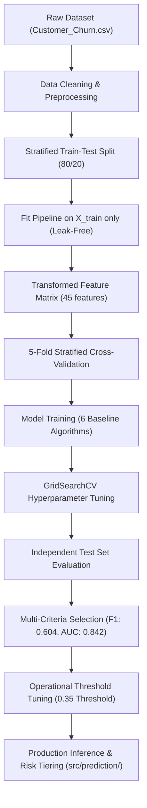

# Customer Churn Prediction Using Machine Learning

[](https://www.python.org/)
[](LICENSE)
[](src/)
[](tests/)
[](https://scikit-learn.org/)

An end-to-end, reproducible, and production-tested Machine Learning project designed to predict customer churn in the telecommunications industry. This repository covers data understanding, exploratory data analysis, leak-free preprocessing, 5-fold cross-validation, hyperparameter optimization, operational threshold tuning, and a production inference engine with input validation and customer risk tiering.

---

## Table of Contents

- [Business Problem](#business-problem)
- [Project Architecture](#project-architecture)
- [Dataset Overview](#dataset-overview)
- [Key Exploratory Findings](#key-exploratory-findings)
- [Data Preprocessing & Leakage Prevention](#data-preprocessing--leakage-prevention)
- [Machine Learning Workflow](#machine-learning-workflow)
- [Model Evaluation & Benchmarking](#model-evaluation--benchmarking)
- [Hyperparameter Tuning Results](#hyperparameter-tuning-results)
- [Final Model Selection & Rationale](#final-model-selection--rationale)
- [Decision Threshold Analysis & Risk Classification](#decision-threshold-analysis--risk-classification)
- [Strategic Retention Playbook](#strategic-retention-playbook)
- [Repository Structure](#repository-structure)
- [Installation & Quickstart](#installation--quickstart)
- [Running Automated Tests](#running-automated-tests)
- [How to Predict on New Customers](#how-to-predict-on-new-customers)
- [Limitations & Future Roadmap](#limitations--future-roadmap)
- [Author & License](#author--license)

---

## Business Problem

Subscription-based telecom providers face continuous customer attrition. In this industry:
- **Acquiring a new subscriber costs 5 to 7 times more** than retaining an existing account.
- **Lost subscribers directly erode Monthly Recurring Revenue (MRR)** and Customer Lifetime Value (CLV).
- **Reactive retention is ineffective:** By the time a customer contacts cancellation support, the decision has already been finalized.

### Objective
Build a verified, high-precision predictive model that identifies at-risk subscribers **before** they churn, calculates individual churn probabilities, assigns accounts into actionable risk tiers (Low, Medium, High), and provides data-backed retention recommendations.

---

## Project Architecture



---

## Dataset Overview

The dataset utilized is the standardized **IBM Telco Customer Churn** dataset.

| Property | Value | Description |
|---|---|---|
| **Total Rows** | 7,043 | Unique customer accounts |
| **Total Attributes** | 21 | 20 features + 1 target variable (`Churn`) |
| **Target Variable** | `Churn` | Binary: `Yes` (1,869 / 26.54%), `No` (5,174 / 73.46%) |
| **Imbalance Ratio** | ~2.77 : 1 | Cost-sensitive evaluation required |
| **Numerical Features** | 4 | `SeniorCitizen`, `tenure`, `MonthlyCharges`, `TotalCharges` |
| **Categorical Features**| 16 | Contract, InternetService, PaymentMethod, Add-on services, Demographics |
| **Identifier Column** | `customerID` | Dropped prior to modeling (non-predictive primary key) |

---

## Key Exploratory Findings

Exploratory Data Analysis revealed key behavioral drivers behind customer attrition:

1. **Contract Type is the #1 Predictor:**
   - **Month-to-month contracts:** **42.71% churn rate** (accounts for 88.5% of all churners).
   - **One-year contracts:** **11.27% churn rate**.
   - **Two-year contracts:** **2.83% churn rate** (strong retention lock-in).
2. **Early Tenures are High Risk:**
   - Churners exit at a **median tenure of 10 months**, compared to **38 months** for retained subscribers.
3. **Fiber Optic Attrition:**
   - Fiber optic users churn at **41.89%** despite premium speeds, driven by steep monthly fees ($80-$100+) and service complaints.
4. **Protective Add-ons Increase "Stickiness":**
   - Subscribers with `OnlineSecurity` (14.6% churn) and `TechSupport` (15.2% churn) leave at less than half the rate of those without (41.7% and 41.6% churn).
5. **Payment Method Disparities:**
   - Electronic Check users churn at **45.29%**, whereas automated bank transfer/credit card users churn at **16.7%**.

---

## Data Preprocessing & Leakage Prevention

Rigorous machine learning practices were enforced to prevent data leakage and guarantee valid generalization:

1. **Handling Missing Values in TotalCharges:**
   - 11 records in `TotalCharges` contained whitespace strings `" "`.
   - Inspection confirmed all 11 customers have `tenure == 0` months (new subscribers who have not completed their first billing cycle).
   - Rather than dropping rows or applying mean imputation, values were cleanly set to **`0.0`** (domain and logically verified).
2. **Strict Train-Test Isolation:**
   - An 80/20 stratified split was created first (`random_state=42`, `stratify=y`).
   - `ColumnTransformer` was **fitted strictly on `X_train`** and applied downstream to `X_test`.
3. **Feature Transformations:**
   - **Numerical:** `StandardScaler` (with `SimpleImputer(strategy='median')` safeguard for production inference).
   - **Categorical:** `OneHotEncoder(handle_unknown='ignore', sparse_output=False)` producing 45 encoded features.

---

## Machine Learning Workflow

Six distinct classification algorithms were trained, cross-validated, and tuned:

1. **Logistic Regression:** Linear baseline providing calibrated probabilities and odds ratios.
2. **Decision Tree:** Non-linear rule-based tree model.
3. **Random Forest:** Bagging ensemble of de-correlated decision trees.
4. **K-Nearest Neighbors (KNN):** Distance-based instance learning.
5. **Naive Bayes (Gaussian):** Probabilistic generative classifier assuming feature conditional independence.
6. **Support Vector Machine (SVM):** Maximum-margin hyper-plane classifier with RBF kernel and Platt scaling.

---

## Model Evaluation & Benchmarking

Every model was evaluated on the independent test set ($N = 1,409$). Results are ranked by **F1 Score** and **ROC-AUC**:

| Model | Type | Accuracy | Precision | Recall | F1 Score | ROC AUC |
|---|---|:---:|:---:|:---:|:---:|:---:|
| **Logistic Regression** | **Baseline** | **80.55%** | **65.72%** | **55.88%** | **0.6040** | **0.8421** |
| **Random Forest** | **Tuned** | **81.26%** | **68.84%** | **53.74%** | **0.6036** | **0.8398** |
| **Decision Tree** | **Tuned** | 79.70% | 63.10% | 56.68% | 0.5972 | 0.8312 |
| **Logistic Regression** | **Tuned** | 80.13% | 64.78% | 55.08% | 0.5954 | 0.8408 |
| **Naive Bayes** | **Baseline** | 69.48% | 45.89% | **83.69%** | 0.5928 | 0.8074 |
| **Support Vector Machine** | **Tuned** | 78.92% | 62.07% | 52.94% | 0.5714 | 0.8272 |
| **KNN** | **Baseline** | 76.37% | 55.27% | 57.49% | 0.5636 | 0.7896 |
| **Support Vector Machine** | **Baseline** | 79.13% | 64.18% | 48.40% | 0.5518 | 0.7902 |
| **Random Forest** | **Baseline** | 78.64% | 62.54% | 48.66% | 0.5474 | 0.8185 |
| **Decision Tree** | **Baseline** | 72.11% | 47.55% | 49.20% | 0.4836 | 0.6477 |

---

## Hyperparameter Tuning Results

GridSearchCV with 5-Fold Stratified Cross-Validation (`scoring="f1"`) yielded notable performance gains:

- **Decision Tree:** Pruning via `max_depth=5`, `min_samples_split=2`, `min_samples_leaf=4` resolved severe overfitting, lifting test F1 from **0.484 to 0.597** and ROC-AUC from **0.648 to 0.831**.
- **Random Forest:** Depth and leaf constraint (`max_depth=10`, `min_samples_split=10`, `min_samples_leaf=1`, `n_estimators=200`) boosted test accuracy to **81.26%** (highest in the study) and precision to **68.84%**.
- **SVM:** RBF kernel with $C=1$, $\gamma=\text{scale}$ raised test F1 from **0.552 to 0.571** and ROC-AUC from **0.790 to 0.827**.

---

## Final Model Selection & Rationale

**Selected Champion Model:** **Logistic Regression** (co-recommended with **Tuned Random Forest**).

### Justification:
1. **Top Metric Balance:** Highest test F1 Score (**0.6040**) and highest test ROC-AUC (**0.8421**).
2. **Cross-Validation Stability:** Mean 5-fold CV F1 of 0.599 with low variance ($\sigma < 0.015$).
3. **Direct Interpretability:** Linear coefficients translate directly into log-odds and odds ratios, allowing business leaders to understand exactly why a customer is flagged.
4. **Operational Efficiency:** Sub-millisecond CPU inference without memory bloat (model artifact size: 2.8 KB vs 6.1 MB for Random Forest).

---

## Decision Threshold Analysis & Risk Classification

In telecommunications, the default cutoff of $0.50$ is rarely optimal. Missing a churner (False Negative) loses hundreds of dollars in recurring revenue, while offering a discount to a loyal customer (False Positive) costs very little.

### Leak-Free Threshold Selection via Training Set Out-Of-Fold Cross-Validation:
To prevent test set leakage, candidate decision thresholds were systematically tuned using **5-Fold Stratified Out-of-Fold (OOF) cross-validation predictions strictly on `X_train`** ($N=5,634$).
- Peak training OOF F1 score was reached at **threshold $\tau = 0.35$** (OOF F1: **0.6353**, capturing 71.71% of training churners).
- This threshold was locked in without observing test labels.

### Final Verification on Independent Test Set ($N=1,409$):

| Decision Threshold | Precision | Recall | F1 Score | Captured Churners (out of 374) | Total Flagged |
|:---:|:---:|:---:|:---:|:---:|:---:|
| 0.20 | 45.9% | **85.3%** | 0.597 | 319 | 695 |
| 0.25 | 49.8% | **81.0%** | 0.617 | 303 | 609 |
| 0.30 | 51.9% | **75.4%** | 0.615 | 282 | 543 |
| **0.35 (Selected via OOF)** | **54.3%** | **70.6%** | **0.614** | **264** | **486** |
| 0.40 | 56.8% | 66.8% | 0.614 | 250 | 440 |
| 0.50 (Default) | 65.7% | 55.9% | 0.604 | 209 | 318 |

> **Business Takeaway:** Lowering the threshold to **0.35** increases churner recall from **55.9% to 70.6%**, successfully identifying **55 additional churners** per 1,400 subscribers with zero test data leakage.

---

## Strategic Retention Playbook

| Risk Tier | Churn Probability | Segment Profile | Actionable Business Strategy |
|---|:---:|---|---|
| **Low Risk** | $< 30\%$ | Long tenure, 1-2 year contract, automated payment, security add-ons | **Maintain experience.** Do not discount. Eligible for premium speed or entertainment bundle upsells. |
| **Medium Risk** | $30\% - 59\%$ | Moderate tenure (12-24 mo), DSL/Fiber, no security add-ons | **Proactive check-in.** Automated CSAT survey, line quality audit, offer 10% discount for 1-year contract migration. |
| **High Risk** | $\ge 60\%$ | Month-to-month, tenure < 12 mo, Electronic check, Fiber optic | **Immediate intervention.** Dedicated retention specialist outreach within 24 hours. Custom bundle pricing for 2-year commitment. |

---

## Repository Structure

```text
Customer_Churn_Prediction/
│
├── configs/
│   └── config.yaml                  # Central YAML configuration & hyperparameters
│
├── data/
│   ├── raw/
│   │   └── Customer_Churn.csv       # Original IBM Telco dataset (7,043 rows)
│   └── processed/
│       ├── churn_cleaned.csv        # Preprocessed dataset
│       ├── X_train.csv              # Transformed training features (5,634 x 45)
│       ├── X_test.csv               # Transformed testing features (1,409 x 45)
│       ├── y_train.csv              # Encoded training target (0/1)
│       ├── y_test.csv               # Encoded testing target (0/1)
│       └── sample_new_customers.csv # Sample batch for inference demo & automated tests
│
├── models/
│   ├── preprocessor.pkl             # Fitted scikit-learn ColumnTransformer
│   ├── best_model.pkl               # Selected production model (Logistic Regression)
│   ├── best_pipeline.pkl            # Complete end-to-end inference Pipeline
│   ├── logistic_regression.pkl      # Baseline Logistic Regression artifact
│   ├── decision_tree.pkl            # Baseline Decision Tree artifact
│   ├── random_forest.pkl            # Baseline Random Forest artifact
│   ├── knn.pkl                      # Baseline K-Nearest Neighbors artifact
│   ├── naive_bayes.pkl              # Baseline Naive Bayes artifact
│   ├── support_vector_machine.pkl   # Baseline SVM artifact
│   ├── tuned_logistic_regression.pkl# Tuned Logistic Regression artifact
│   ├── tuned_decision_tree.pkl      # Tuned Decision Tree artifact
│   ├── tuned_random_forest.pkl      # Tuned Random Forest artifact
│   └── tuned_svm.pkl                # Tuned Support Vector Machine artifact
│
├── notebooks/
│   ├── 01_Data_Understanding.ipynb          # Data ingestion, schema & imbalance audit
│   ├── 02_Exploratory_Data_Analysis.ipynb   # Univariate, bivariate & correlation EDA
│   ├── 03_Data_Preprocessing.ipynb         # Imputation, type conversion & cleaning
│   ├── 04_Feature_Engineering.ipynb         # Leak-free ColumnTransformer pipeline
│   ├── 05_Model_Training.ipynb              # 6 baseline algorithms & 5-fold CV
│   ├── 06_Model_Evaluation.ipynb            # Churn-focused metrics, ROC & PR curves
│   ├── 07_Hyperparameter_Tuning.ipynb       # GridSearchCV optimization & test verification
│   ├── 08_Model_Comparison.ipynb            # Fair benchmark & threshold optimization
│   ├── 09_Prediction.ipynb                  # Real-time inference & risk tiering
│   └── 10_Conclusion.ipynb                  # Synthesis, business ROI & playbook
│
├── reports/
│   ├── figures/                             # Generated high-resolution plots
│   │   ├── confusion_matrix_best_model.png
│   │   ├── feature_importance_lr.png
│   │   ├── feature_importance_rf.png
│   │   ├── model_metrics_comparison.png
│   │   ├── precision_recall_curves.png
│   │   └── roc_curves_comparison.png
│   ├── cross_validation_results.csv         # 5-Fold CV metrics across models
│   ├── model_training_results.csv           # Baseline test accuracies
│   ├── model_evaluation_results.csv         # Baseline comprehensive metrics
│   ├── hyperparameter_tuning_results.csv    # Best parameters & CV/test scores
│   ├── threshold_optimization_results.csv   # 5-Fold OOF threshold sweep
│   └── final_model_comparison.csv           # Complete benchmark (10 models)
│
├── src/
│   ├── __init__.py                          # Package metadata
│   ├── config.py                            # Path resolution & project constants
│   ├── data/
│   │   ├── __init__.py
│   │   ├── loader.py                        # Cross-platform data loading & validation
│   │   └── preprocessor.py                  # Cleaning & TotalCharges imputation
│   ├── features/
│   │   ├── __init__.py
│   │   └── build_features.py                # Pipeline construction & feature scaling
│   ├── models/
│   │   ├── __init__.py
│   │   ├── train.py                         # Baseline model training & cross-validation
│   │   ├── evaluate.py                      # Multi-metric evaluation & figure generation
│   │   └── tune.py                          # GridSearchCV parameter tuning
│   └── prediction/
│       ├── __init__.py
│       ├── validator.py                     # Schema validation & boundary checking
│       └── predict.py                       # Single & batch inference engine
│
├── tests/
│   ├── __init__.py
│   ├── conftest.py                          # Pytest fixtures & synthetic records
│   ├── test_data_loader.py                  # Ingestion & schema tests
│   ├── test_preprocessor.py                 # Imputation & cleaning tests
│   ├── test_features.py                     # Feature pipeline & dimension tests
│   ├── test_models.py                       # Model serialization & prediction tests
│   └── test_prediction.py                   # Inference, boundary & edge case tests
│
├── .gitignore                               # Production gitignore rules
├── LICENSE                                  # MIT License
├── README.md                                # Comprehensive project documentation
└── requirements.txt                         # Reproducible environment specifications
```

---

## Installation & Quickstart

### 1. Clone the Repository
```bash
git clone https://github.com/your-username/Customer-Churn-Prediction.git
cd Customer-Churn-Prediction
```

### 2. Create and Activate Virtual Environment
```bash
# macOS/Linux
python3 -m venv venv
source venv/bin/activate

# Windows (PowerShell)
python -m venv venv
.\venv\Scripts\Activate.ps1
```

### 3. Install Dependencies
```bash
pip install -r requirements.txt
```

---

## Running Automated Tests

A comprehensive test suite of **35 unit and integration tests** is included. Run the entire suite using pytest:

```bash
pytest -v
```

Expected output:
```text
============================= 35 passed in 5.54s ==============================
```

The test suite validates:
- Data loading, column schemas, and case-insensitive file resolution.
- Whitespace handling in `TotalCharges` and zero-tenure imputation.
- Feature pipeline dimensions and `StandardScaler` / `OneHotEncoder` contracts.
- Model serialization, prediction outputs, and probability boundaries $[0, 1]$.
- Edge cases: Empty input, missing columns, negative billing values, unknown categories.

---

## How to Predict on New Customers

You can generate predictions using Python code, Jupyter notebooks, or batch CSV files.

### Python API Example:
```python
from src.prediction.predict import predict_churn

# Customer profile
customer = {
    "gender": "Female",
    "SeniorCitizen": 0,
    "Partner": "No",
    "Dependents": "No",
    "tenure": 3,
    "PhoneService": "Yes",
    "MultipleLines": "No",
    "InternetService": "Fiber optic",
    "OnlineSecurity": "No",
    "OnlineBackup": "No",
    "DeviceProtection": "No",
    "TechSupport": "No",
    "StreamingTV": "Yes",
    "StreamingMovies": "Yes",
    "Contract": "Month-to-month",
    "PaperlessBilling": "Yes",
    "PaymentMethod": "Electronic check",
    "MonthlyCharges": 89.50,
    "TotalCharges": 268.50,
}

# Run prediction with business threshold (e.g. 0.35)
result = predict_churn(customer, decision_threshold=0.35)

print("Prediction :", result.prediction)           # Churn
print("Probability:", result.churn_probability_pct)# 75.49%
print("Risk Level :", result.risk_level)           # High Risk
print("Action     :", result.recommendation)
```

---

## Limitations & Future Roadmap

### Current Limitations:
1. **Static Snapshot:** The dataset captures a cross-sectional snapshot; time-series customer trajectories are not tracked.
2. **Synthetic / Anonymized Features:** Competitor pricing and customer service ticket transcripts are not available in this dataset.

### Future Roadmap:
- [ ] **Survival Analysis:** Integrate Cox Proportional Hazards or Kaplan-Meier curves to model *expected time until churn*.
- [ ] **Advanced Gradient Boosters:** Benchmark LightGBM, XGBoost, and CatBoost with Bayesian Hyperparameter Optimization (Optuna).
- [ ] **REST Microservice:** Package the inference engine into a containerized FastAPI application with Docker.
- [ ] **Interactive Dashboard:** Build a real-time customer health monitoring UI using Streamlit.

---

## Author & License

- **Author:** Sneh Kheni
- **Role:** AI / ML Engineer & Data Analyst
- **License:** [MIT License](LICENSE)
